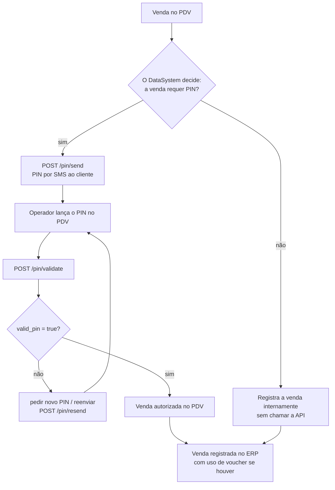
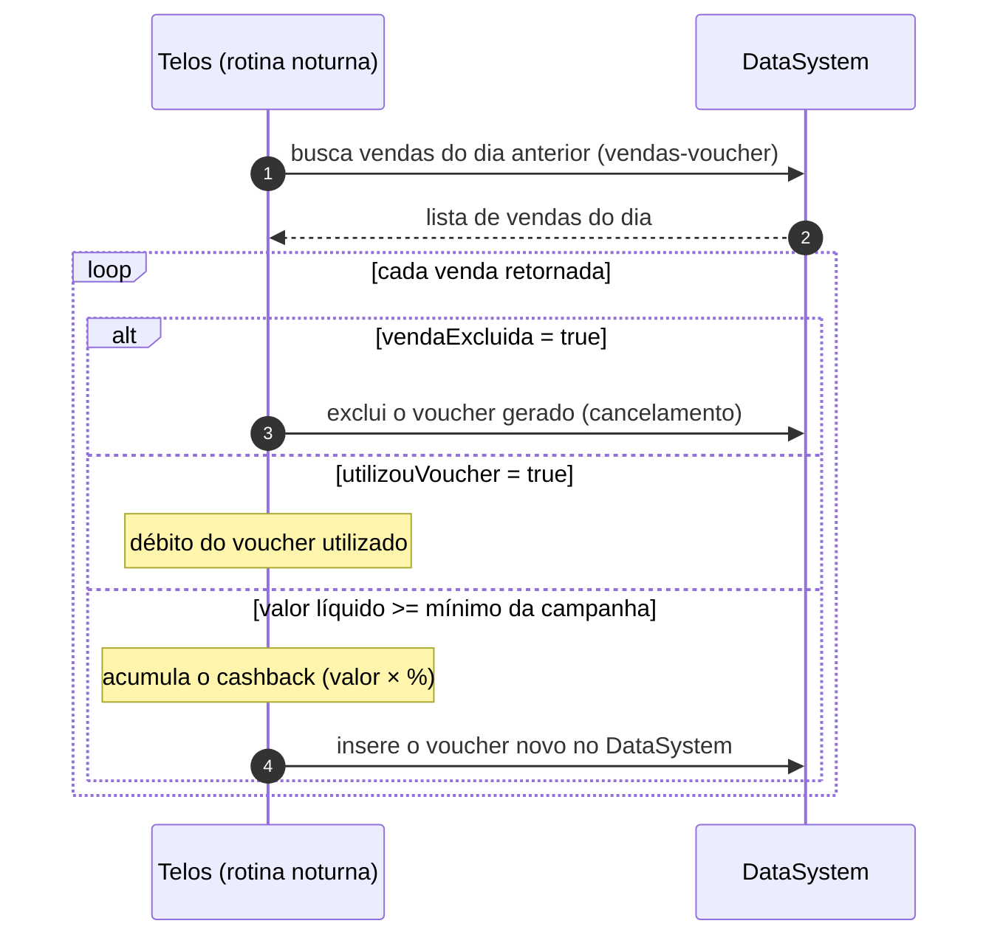

# Como funciona a integração

A divisão de responsabilidades define tudo: **o DataSystem controla os vouchers
e decide as vendas; a Telos envia/valida o PIN e processa o cashback D+1**.

## O fluxo no balcão (tempo real — lado DataSystem)

- **A decisão de exigir PIN é do DataSystem** (regra interna da loja) — a API
  não tem `user/verify` nem `request_pin` como no fluxo padrão.
- Se **não** requer PIN: **nenhuma chamada à API** — a venda é registrada no
  ERP e o acúmulo sai dela no D+1.
- Se **requer PIN**: `/pin/send` → `/pin/validate` (→ `/pin/resend` se o cliente
  pedir). O uso do voucher é verificado e aplicado **internamente no ERP**.
  Ver o detalhe completo em [Validação de PIN](./pin).

## O fluxo D+1 (rotina noturna — lado Telos)

Nada para o ERP fazer aqui — é contexto para entender o modelo:

O acúmulo, o débito do voucher usado e os cancelamentos são processados pela
Telos na rotina noturna, a partir das vendas registradas no ERP.

## O que esta API NÃO tem (e por quê)

| Rota do fluxo padrão | Situação na integração DataSystem |
| --- | --- |
| `/user/verify` | **Não existe** — o cadastro do cliente acontece no `/pin/send` |
| `/bonus/balance`, `/bonus/available`, `/bonus/campaigns` | **Não existem** — o voucher é controlado pelo próprio ERP |
| `/bonus/submit` | **Não existe** — o débito do voucher é interno; o acúmulo é D+1 |
| `/sales/total`, `/sales/cancel` | **Não existem** — as vendas são lidas pelo D+1 no ERP |

## Regras que valem para toda a integração

1. **A decisão de exigir PIN é sempre do DataSystem** — a API só executa o
   que for solicitado.
2. **O PIN vai sempre como string JSON** (`"0427"`), mesmo começando com zero.
3. **IDs são opacos** (`user_id`): recebeu, guardou, ecoou.
4. **Renove o token preventivamente** (access 1h; refresh single-use) — ver
   [Primeiros passos](../guia/primeiros-passos).
5. **O DataSystem compara status e texto das respostas** — as mensagens
   documentadas são contratos (ver [Erros](../guia/erros)).
