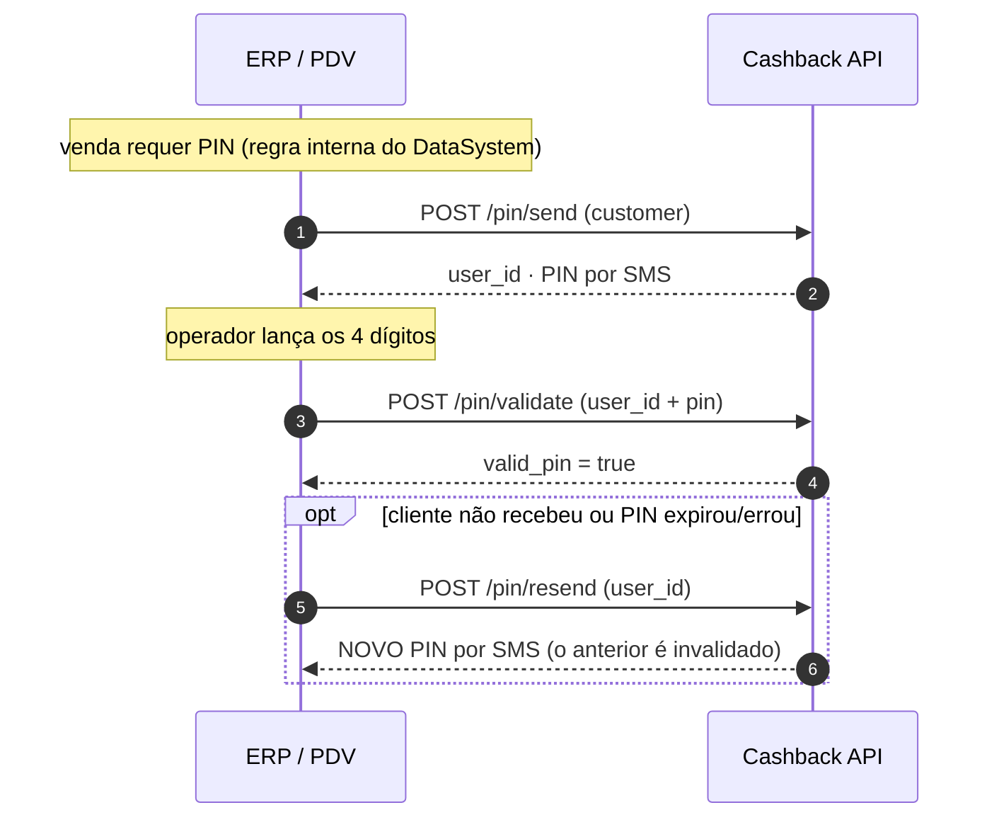

# Validação de PIN

O fluxo de PIN é o único momento em que a integração toca a API durante a
venda: enviar o SMS, validar os 4 dígitos e — se necessário — reenviar.

**Regras do PIN (por loja, configuradas na Telos):**

| Regra | Valor |
| --- | --- |
| Validade do PIN | **5 minutos** |
| Tentativas de validação | **3 por PIN** |
| Janela entre disparos de SMS | **60 segundos** |

## Visão geral



## Passo a passo

As chamadas abaixo usam a **homologação**:

```bash
BASE_URL="https://giftback.hom.teloscrm.com.br/api/v1/datasystem"
TOKEN="eyJ0eXAi..."   # access_token do /auth (ver Primeiros passos)
```

### 1. Envie o PIN por SMS

O `customer` identifica e cria/atualiza o cliente:

::: code-group

```bash [curl]
curl -s -X POST "$BASE_URL/pin/send" \
  -H "Authorization: Bearer $TOKEN" -H "Content-Type: application/json" \
  -d '{
    "seller_name": "Leonardo Campos",
    "customer": {
        "document_number": "11144477735",
        "name": "Maria Souza",
        "phone": "11988887777"
    }
  }'
```

```php [Laravel]
$response = Http::withToken($token)->post("$baseUrl/pin/send", [
    'seller_name' => 'Leonardo Campos',
    'customer' => [
        'document_number' => '11144477735',
        'name' => 'Maria Souza',
        'phone' => '11988887777',
    ],
])->throw()->json();

$userId = $response['data']['user_id'];
```

:::

```json
{
    "status": true,
    "message": "Pin successfully sent",
    "data": {
        "user_id": "0zXtCRB91brXqq92ud5KqQ==",
        "request_pin": true,
        "text_pin": "TELOS Giftback: PIN 3885 - Ao passar pin você concorda com https://www.telosdigital.com.br/termos-uso"
    }
}
```

- O `user_id` retornado é obrigatório no `/pin/validate` e no `/pin/resend`.
- Campos opcionais de `customer` (e-mail, nascimento, sexo) e o carrinho
  (`gross_value`, `items`) podem ser enviados para enriquecer o cadastro.
- **A validade conta a partir daqui**: o PIN vale **5 minutos**.

::: tip O clique repetido no "enviar" não é erro
Repetição em menos de 60s (mesmo telefone, PIN ainda ativo) responde **200** com
o **mesmo PIN** — nenhum SMS novo é disparado. Se o SMS anterior **falhou**, a
janela já foi liberada e o novo envio dispara de verdade.
:::

### 2. Valide os 4 dígitos

::: code-group

```bash [curl]
curl -s -X POST "$BASE_URL/pin/validate" \
  -H "Authorization: Bearer $TOKEN" -H "Content-Type: application/json" \
  -d '{"user_id":"0zXtCRB91brXqq92ud5KqQ==","pin":"3885"}'
```

```php [Laravel]
// O PIN vai SEMPRE como string JSON — "0427", nunca 0427.
$response = Http::withToken($token)->post("$baseUrl/pin/validate", [
    'user_id' => $userId,
    'pin' => '3885',
])->throw()->json();

$validPin = $response['data']['valid_pin'];
$pinMaster = $response['data']['pin_master'];
```

:::

```json
{
    "status": true,
    "message": "Success",
    "data": {
        "user_id": "0zXtCRB91brXqq92ud5KqQ==",
        "valid_pin": true,
        "pin_master": false
    }
}
```

- `valid_pin = true` → venda autorizada: **fim do fluxo de PIN** (a venda segue
  no ERP; o cashback sai no D+1).
- `valid_pin = false` → PIN errado, **expirado (5 min)** ou **esgotou as 3
  tentativas**: peça novo PIN ou reenvie.
- **400** aqui é body malformado — o detalhe completo (mensagens exatas, ordem
  de validação, o porquê do PIN como string) está em
  [Erros e novas tentativas](../guia/erros).
- `pin_master = true` → a validação foi feita com o PIN master (uso
  operacional, sem SMS). Campo informativo — o fluxo segue igual.

### 3. Reenvie quando necessário

O `/pin/resend` **gera um PIN NOVO e invalida o anterior** (diferente do
"clique repetido" do `/pin/send`, que reaproveita o PIN ativo):

::: code-group

```bash [curl]
curl -s -X POST "$BASE_URL/pin/resend" \
  -H "Authorization: Bearer $TOKEN" -H "Content-Type: application/json" \
  -d '{"user_id":"0zXtCRB91brXqq92ud5KqQ=="}'
```

```php [Laravel]
$response = Http::withToken($token)->post("$baseUrl/pin/resend", [
    'user_id' => $userId,
])->throw()->json();
```

:::

```json
{
    "status": true,
    "message": "Success",
    "data": {
        "user_id": "0zXtCRB91brXqq92ud5KqQ==",
        "text_pin": "TELOS Giftback: PIN 3575 - Reenvio solicitado - https://www.telosdigital.com.br/termos-uso"
    }
}
```

- Respeita a janela de **60s** do último disparo — dentro dela, **429**
  `Aguarde 60 segundos antes de reenviar o PIN.` (a UI deve bloquear o botão).
- O PIN novo **invalida o anterior**: o antigo não valida mais, mesmo dentro
  dos 5 minutos.
- O reenvio **reinicia a validade e as tentativas** (novo PIN, nova janela de
  5 minutos, novas 3 tentativas).

## Erros deste fluxo

| Passo | Resposta | O que fazer |
| --- | --- | --- |
| `/pin/send` | `400 Dados inválidos: <primeiro erro>` | Corrigir o payload (CPF 11 dígitos, nome, telefone 10–11) |
| `/pin/send` | `429` (telefone mudou na janela ou PIN já validado) | Aguardar a janela de 60s — clique repetido normal responde 200 |
| `/pin/validate` | `200 valid_pin = false` | PIN errado/expirado/esgotou tentativas — novo PIN ou reenvio |
| `/pin/validate` | `400 Dados inválidos: …` | Body malformado — ver [Erros](../guia/erros) |
| `/pin/validate` | `404 Usuário não encontrado` | `user_id` de outra sessão — refazer o `/pin/send` |
| `/pin/resend` | `429` | Dentro da janela de 60s — bloquear o botão na UI |

Regras completas em [Erros e novas tentativas](../guia/erros).

## Checklist

Antes de ligar o fluxo no caixa real, confira:

- [ ] Credenciais da loja operando (hom e prod separadas)
- [ ] A regra interna de "quando a venda requer PIN" implementada no ERP
- [ ] O PIN sempre como **string JSON**
- [ ] `user_id` do `/pin/send` reaproveitado no validate e no resend
- [ ] Validade (5 min) e tentativas (3) tratadas na UI do caixa
- [ ] Janela de 60s do resend respeitada (botão bloqueado)
- [ ] `409`/`400` tratados como erro de payload, não como "PIN errado"
